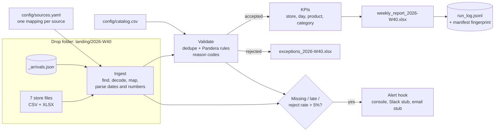

# Messy store files → validated weekly Excel report

**Every Monday, 8 stores' CSV/Excel exports get cleaned, merged, checked and turned into one
weekly sales report, plus a list of every rejected row and why it was rejected. Nobody has to
fix files by hand.**

This is a portfolio demo built on **synthetic data** for a **fictional** company (Fernhill
Coffee Co.). It is the same shape as the job posts I see most: *"clean and merge messy
CSV/Excel files"*, *"automate a weekly report"*, *"build a small ETL pipeline"*.

 

## What it handles

| Real-world mess | What the pipeline does |
|---|---|
| Every store names columns differently (`Txn #`, `Order No`, `Beleg`…) | One YAML mapping per source maps them to one schema |
| Dates as `2026-09-28`, `28/09/2026`, `09/28/2026`, `28.09.2026`, real Excel dates, timezones | Tries each configured format; unreadable dates → `BAD_DATE` |
| A Windows-1252 file labelled UTF-8, semicolons, decimal commas, `$4.50` | Encoding fallback (logged), per-source delimiter and decimal, currency stripping |
| Double-encoded names (`Café Crème`) | Repaired to `Café Crème` |
| The same lines exported twice | Removed and listed as `DUPLICATE` |
| Blank SKUs or quantities, negative quantities, `99` typed for `1`, 10x price typos, unknown SKUs, dates from last week | Pandera rules; each rejected row gets reason codes |
| One store never sends its file; another sends it late | Report still builds; the source is marked `MISSING`/`LATE` and an alert fires |
| Someone re-runs the job | Same inputs → no-op. Changed inputs → that week is rebuilt. Files are written atomically. |

## Architecture



## 90-second quickstart

```bash
git clone <this repo> && cd weekly-report
python -m pip install -r requirements.txt
make demo      # generate a messy synthetic week, then build the report (about 5 s)
make rerun     # shows the safe re-run: "No changes since the last run ... Skipping"
make test      # 19 tests, about 3 s, no network
```

With Docker (the image is built in CI; I could not build it in my dev container):

```bash
docker build -t weekly-report .
docker run --rm -v "$PWD/output:/app/output" weekly-report
```

Open `output/2026-W40/weekly_report_2026-W40.xlsx` and `exceptions_2026-W40.xlsx`. Copies
from the real run are committed in [`sample_output/`](sample_output/).

## Results (synthetic data, printed by `make demo`)

| Source | Status | Rows read | Accepted | Rejected |
|---|---|---:|---:|---:|
| Downtown | OK | 5,200 | 5,174 | 26 |
| Harbor | OK | 4,100 | 4,059 | 41 |
| Uptown | OK | 3,000 | 2,970 | 30 |
| Airport | OK | 3,914 | 3,781 | 133 |
| Campus | OK | 2,200 | 2,092 | 108 |
| Online | OK | 3,300 | 3,267 | 33 |
| Mall | MISSING | 0 | 0 | 0 |
| Station | LATE | 2,600 | 2,574 | 26 |
| **Total** | | **24,314** | **23,917** | **397** |

| Metric | Value |
|---|---:|
| Net revenue | 175,097.30 |
| Orders | 14,872 |
| Units sold | 45,248 |
| Average order value | 11.77 |
| Duplicate lines removed | 114 |
| Reject rate | 1.63% |
| Alerts raised | 2 (Mall missing, Station late) |
| Pipeline run time | about 1.6 s (on the dev container) |

All numbers come from seeded fake data (`seed=42`). They show what the pipeline does, not
anyone's business.

### What's in the outputs
- **Weekly report:** Summary (KPIs + a colour-coded status for each source file), By store
  (with a bar chart), By day, Top products, By category.
- **Exceptions report:** every rejected row with its source file, the row number as the
  client sees it in their file, the reason code(s) and the original values. It also has a
  count by reason and a glossary of reason codes. Store managers can fix the data at the
  source.
- **Run log:** `output/run_log.jsonl` has one line per run (rows, rejects, alerts,
  duration, input fingerprint).

## Scheduling

[`cron/crontab.example`](cron/crontab.example) runs the job Monday 07:05, after the 06:00 file
cutoff, and again at 12:05 to pick up late files. Unchanged weeks are skipped. The same
command works from Windows Task Scheduler, a GitHub Actions `schedule:`, or Airflow if you
already have it.

## How your data would plug in

1. **Point it at your files.** That can be a shared folder, an SFTP drop, email
   attachments saved by a rule, or a Google Drive/OneDrive sync. Each one ends up in
   `landing/<week>/`.
2. **Add one YAML block per source.** It sets the file pattern, the encoding, and the column
   names as they appear in your exports. A new store means no code changes.
3. **Swap the catalog and rules.** Use your product list, price tolerance, limits, and
   reporting week or month.
4. **Choose where the report goes.** It can stay in a folder, be emailed, go to SharePoint
   or Drive, or the same tables can be loaded into Postgres or BigQuery for a dashboard.
5. **Turn on alerts.** Set `SLACK_WEBHOOK_URL` or `ALERT_EMAIL_TO` + `SMTP_HOST`. Both are
   stubbed in this demo; the real call is one line, marked in `alerts.py`.

## What I'd ask in discovery

- Where do the files come from, who sends them, and by what time?
- Can I see 2-3 real examples of each, including a bad week?
- What should happen to a bad row: reject, fix automatically, or include but flag?
- Which numbers does the report need, for whom, and in what format (Excel, PDF, dashboard)?
- Is there a master list (products, stores, customers) to check against?
- Where should it run (your server, a cloud VM, GitHub Actions), and who gets alerts?

## Not included

- Real connectors (SFTP, Gmail, Drive, SharePoint, Shopify). They are easy to add per
  client; they're left out so the demo runs offline.
- A web dashboard. The outputs are Excel files on purpose; most small teams live in Excel.
- Live Slack/email sending. Those are stubs.
- Multi-week trend analysis and currency conversion.

## Project layout

```
config/          pipeline.yaml (rules, cutoff), sources.yaml (one block per source), catalog.csv
src/weekly_report/
  generate.py    seeded messy-data generator (fictional company)
  ingest.py      find files, decode, map columns, parse dates and numbers
  validate.py    dedupe + Pandera rules -> reason codes
  transform.py   KPIs
  report.py      formatted Excel report + exceptions file (atomic writes)
  alerts.py      console alert + Slack/email stubs
  cli.py         generate | run, fingerprinting, run log
tests/           19 tests: parsing, every reason code, end-to-end, safe re-runs
cron/            crontab example
sample_output/   report + exceptions from the synthetic run, for screenshots
```

Stack: Python 3.11, pandas, Pandera, openpyxl, PyYAML, pytest, Docker, GitHub Actions.

---
Built by Javidan Abdullayev, a data engineer (Python, SQL, ETL). Hire me on Upwork:
https://www.upwork.com/freelancers/~01b44b432ab6741528
